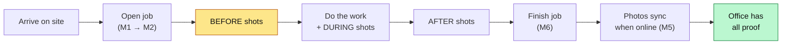
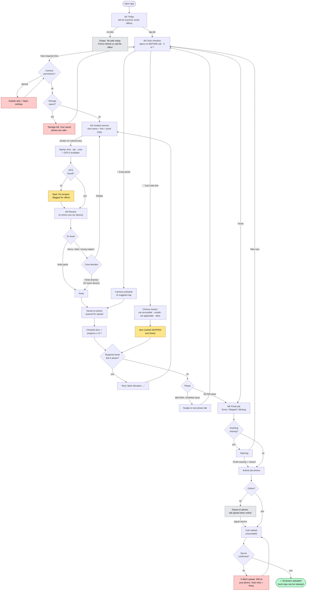
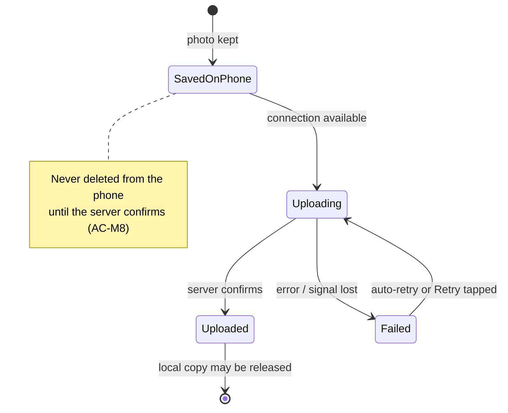

# Crew User Flow: Mobile Photo Capture

Define stage. Maps Part A of the [UX plan](03-ux-design-plan.md) end to end: the happy path, every
decision point, and the recovery paths. Screen IDs (M1–M6) and acceptance criteria (AC-M…) refer to doc 03.

**Scenario used:** Ravi arrives at *14 Elm St, Re-roof*. There's no signal on the roof.

**Presentation diagram:** [diagrams/crew-user-flow.svg](diagrams/crew-user-flow.svg)

---

## 1. Overview: the whole job, at a glance

Before photos are prompted **first**, because a missing before photo is what loses disputes (E9).

---

## 2. Detailed flow: capture loop with decisions and recovery

**Colour key:** green = success · amber = flagged but allowed · red = error/recovery · grey = neutral
info (offline is *not* an error). In the real UI every state also has a **text label and icon**, never
colour alone.

---

## 3. Background: upload queue (runs alongside everything)

The sync runs **independently** of the capture flow. The crew never has to wait for it.

Global sync bar (on every screen, tap → M5): *Offline · 12 saved on phone* → *Uploading 3 of 12* →
*All uploaded ✓* / *4 failed: tap to retry*.

---

## 4. Step-by-step table

| # | Step | Screen | Crew does | System does | Key states | ♿ Accessibility | AC |
|---|---|---|---|---|---|---|---|
| 1 | Open job | M1 | Taps today's job | Loads cached jobs offline | Empty / loading skeleton | Cards announce progress "Before 0 of 7" | AC-M1 |
| 2 | See what's needed | M2 | Reads Before list | Opens on Before tab | Empty slots with names | Phase headings; status as text + icon | AC-M1 |
| 3 | Start shot | M2 → M3 | Taps **Next required shot** | Checks permission + storage | Permission denied, storage full | 56–64 dp button in thumb zone | n/a |
| 4 | Frame | M3 | Follows hint | Shows proof chips (time, GPS, offline) | GPS searching | Hint is screen-reader readable | AC-M3 |
| 5 | Capture | M3 | Shutter or **volume key** | Stamps time, job, crew, GPS | No GPS → flagged | Haptic + sound on capture | AC-M3, M4 |
| 6 | Review | M4 | Keep / Retake | On-device AI check (≤1–2 s) | Good / flagged / AI unavailable | AI result announced as text | AC-M5 |
| 7 | Save | M4 → M2 | n/a | Saves locally, queues, ticks item | Offline (neutral) | Live-region "Saved. 1 of 7." | AC-M2 |
| 8 | Next | M3 | Taps "Next: …" | Advances to next missing shot | Phase complete nudge | No swipe-only actions | n/a |
| 9 | Skip (if needed) | M2 | ⋯ → reason | Marks **Skipped**, not Done | n/a | Reasons are big tap options, no typing | AC-M6 |
| 10 | Finish | M6 | Reviews summary → Submit | Shows Done / Skipped / Missing | Missing warning | Summary readable as a list | AC-M10 |
| 11 | Leave site | Any | Switches job / logs out | Warns if photos unsent | Unsent warning | Count stated in words | AC-M9 |
| 12 | Sync | M5 (background) | Nothing (or Retry) | Auto upload, resumable, retry | Uploading / failed / done | Status changes announced + haptic | AC-M7, M8 |

---

## 5. Decision points (what the crew can choose, and what the system enforces)

| Decision | Who decides | Rule |
|---|---|---|
| Keep a photo the AI flagged | **Crew** | AI advises, never blocks (A14) |
| Mark a required shot done without a photo | **Not allowed** | Only via *Skip + reason* |
| Finish with missing shots | **Crew**, with a reason | Office sees the reason (honest "done") |
| Delete a photo from the phone | **System**, after server confirms | Prevents "half never make it" (E8) |
| Retake | **Crew** | Original is kept hidden for audit |
| Photo has no GPS | **System** saves anyway | Flagged "No location" for the office (E10) |

---

## 6. Where AI shows up in the crew flow (and where a person checks)

| Point | AI does | Person checks |
|---|---|---|
| Review (M4) | Blur / dark / "doesn't look like a roof" | Crew keeps or retakes |
| Extra photo | Suggests area tag (e.g. "Gutter") | Crew confirms, or the office confirms later |
| Finish (M6) | *(not used)* | Crew judges completeness; AI does not decide "done" |

---

## 7. Open questions to test with the prototype
- Do crews follow **Next required shot**, or browse the list? (tests A7)
- Is **Skip + reason** fast enough that crews don't fake a photo instead?
- Does the **sync bar** make them trust the app enough to stop uploading at night? (A18)
- Is the AI warning helpful or annoying after the 50th photo?
