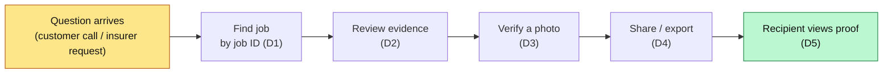
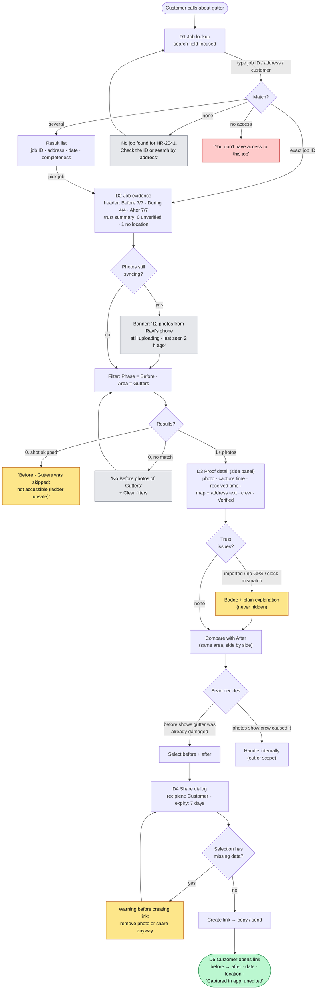
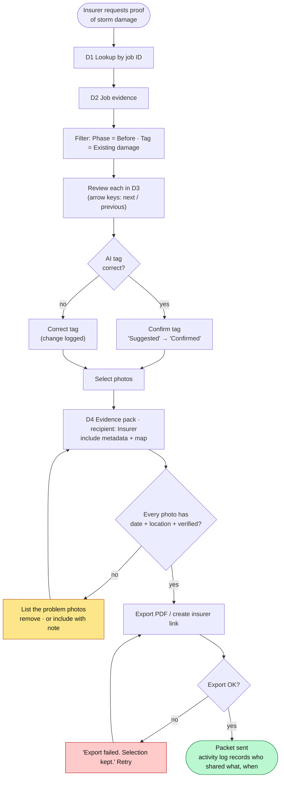
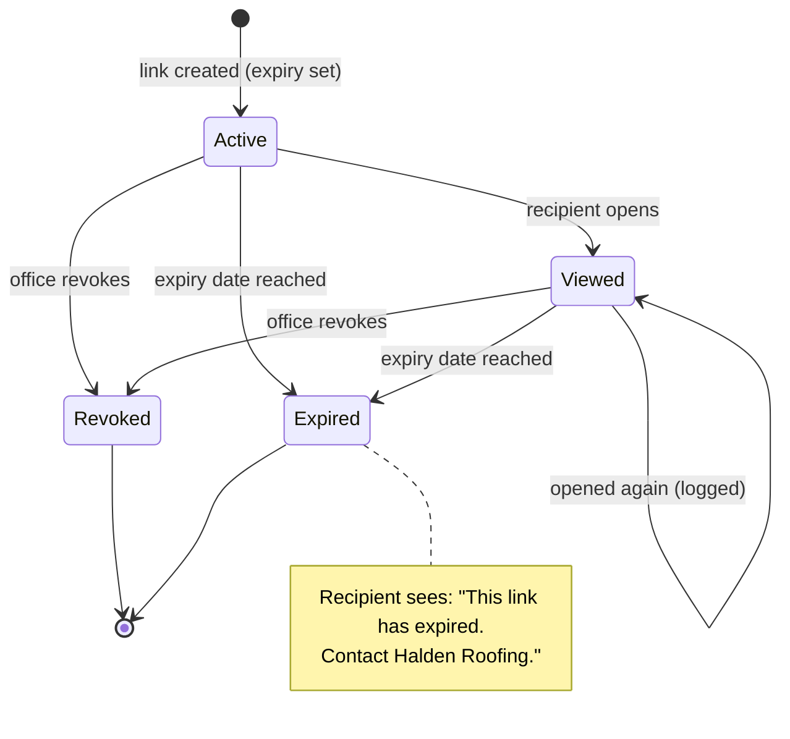

# Office User Flow: Desktop Evidence Review (by Job ID)

Define stage. Maps Part B of the [UX plan](03-ux-design-plan.md) end to end. Screen IDs (D1–D5) and
acceptance criteria (AC-D…) refer to doc 03. Companion to the [crew flow](04-crew-user-flow.md).

**Presentation diagram:** [diagrams/office-evidence-review-flow.svg](diagrams/office-evidence-review-flow.svg)

**Scenarios used**
- **Sean (PM), dispute:** a customer calls: "your crew broke my gutter." He has the job ID on screen.
- **Priya (claims), insurer packet:** an insurer asks for dated, located photos of existing storm damage.

---

## 1. Overview: from question to proof

Target: Sean can answer the customer **while still on the call** (lookup → before photo in under a minute).

---

## 2. Detailed flow: dispute (Sean)

---

## 3. Detailed flow: insurer evidence pack (Priya)

**Colour key** (same as the crew flow): green = success · amber = flagged but allowed · red = error ·
grey = neutral info. In the UI, every state also has a **text label and icon**.

---

## 4. Share link lifecycle

---

## 5. Step-by-step table

| # | Step | Screen | Office user does | System does | Key states | ♿ Accessibility | AC |
|---|---|---|---|---|---|---|---|
| 1 | Find job | D1 | Types job ID | Exact ID jumps to job; partial shows list | No results, no access | Labelled search, focused on load; "3 jobs found" announced | AC-D1, D2 |
| 2 | Read job health | D2 | Scans header | Completeness per phase + trust summary | Still syncing banner | Summary is text, not only colour/icons | AC-D3, D10 |
| 3 | Narrow down | D2 | Applies filters | Filters shown as chips | 0 results, skipped-with-reason | Chips keyboard removable; result count announced | AC-D4 |
| 4 | Inspect photo | D3 | Opens a thumbnail | Side panel with proof block | Loading blur → full | Focus moves into panel; Esc returns; arrow keys next/prev | AC-D5 |
| 5 | Check trust | D3 | Reads badges | Explains imported / no GPS / clock mismatch | Warnings | Location as text + map; badges have text | AC-D6 |
| 6 | Compare | D3 | "Compare with After" | Side-by-side by area | No matching after | Labelled "Before" / "After" in text | AC-D7 |
| 7 | Confirm AI tags | D3 | Confirm or correct | Tag moves from Suggested to Confirmed; change logged | n/a | Tag state stated in words | AC-D11 |
| 8 | Share / export | D4 | Selects, picks recipient | Warns about missing data **before** creating | Export loading / failed | Dialog focus-trapped; warnings announced | AC-D8 |
| 9 | Recipient views | D5 | n/a | Read-only page, no login, only selected photos | Expired / revoked | Plain language; mobile friendly; alt text | AC-D9 |
| 10 | Audit | D3 activity | Checks who viewed | Logs views, shares, tag edits | n/a | Activity as readable list | n/a |

---

## 6. Decision points

| Decision | Who decides | Rule |
|---|---|---|
| Is this photo trustworthy? | **Person** (Sean / Priya) | System shows the facts and badges; it does not declare "fraud" or "safe" |
| Which photos to share | **Person** | Nothing is shared by default; recipient sees only the selection |
| Share a photo with missing data | **Person**, after a warning | Warning comes **before** the link, never after |
| Accept an AI tag | **Person** | Tags stay "Suggested" until confirmed (E13) |
| Who caused the damage | **Person** | AI does **not** assess damage (out of scope, liability) |
| Link expiry / revoke | **Person**, with a default | Default expiry (e.g. 7 days), revocable any time |

---

## 7. Where AI shows up in the office flow (and where a person checks)

| Point | AI does | Person checks |
|---|---|---|
| Filters | Area tags make "Gutters" filterable | Confirms or corrects tags |
| Trust summary | Flags clock mismatch, missing GPS, duplicates | Decides whether to share |
| Search (later) | Natural-language search, e.g. "before photos of the gutter" | Picks the right photo |
| Damage judgement | **Not used** | Always a person |

---

## 8. How this connects to the crew flow

| Crew does (doc 04) | Office sees (this doc) |
|---|---|
| Takes Before shots first | Before 7/7 in the header; before ↔ after pairing works |
| Skips a shot with a reason | "Skipped: not accessible" instead of an empty gap |
| Photo with no GPS | "No location" badge + warning before sharing |
| Imports from gallery | "Imported, not verified" badge everywhere |
| Phone still offline | "Still uploading · last seen 2 h ago" banner |

---

## 9. Open questions to test
- Is **job ID** really the starting point, or do PMs search by customer name or address during a call? (A15)
- Do PMs trust the **Verified** badge without understanding what it means? Is a plain explanation needed?
- Is a **link** enough for insurers, or do they require a PDF? (A16)
- Does showing **Skipped + reason** help or hurt in a dispute?
